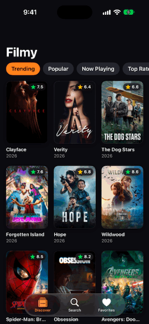
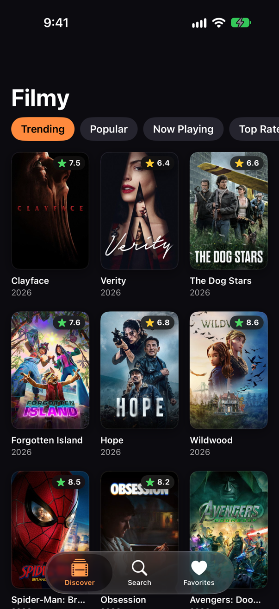
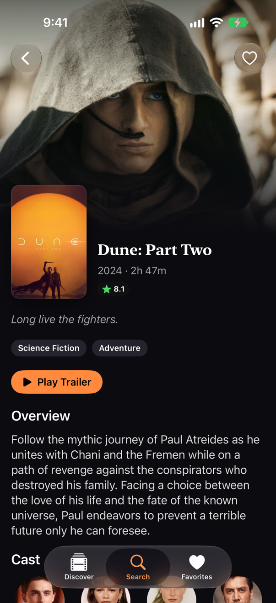
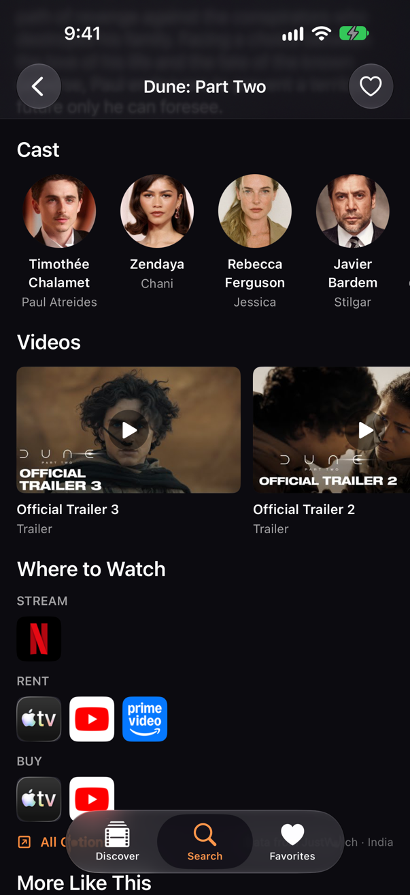
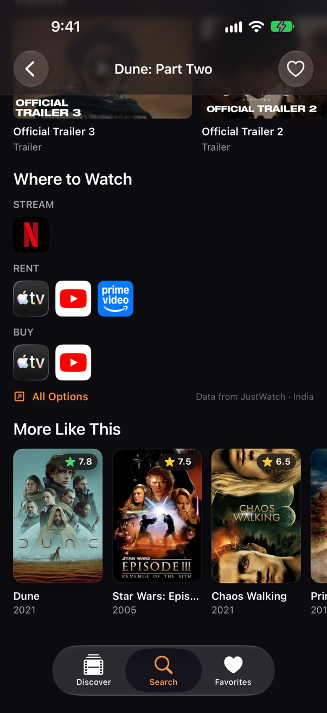
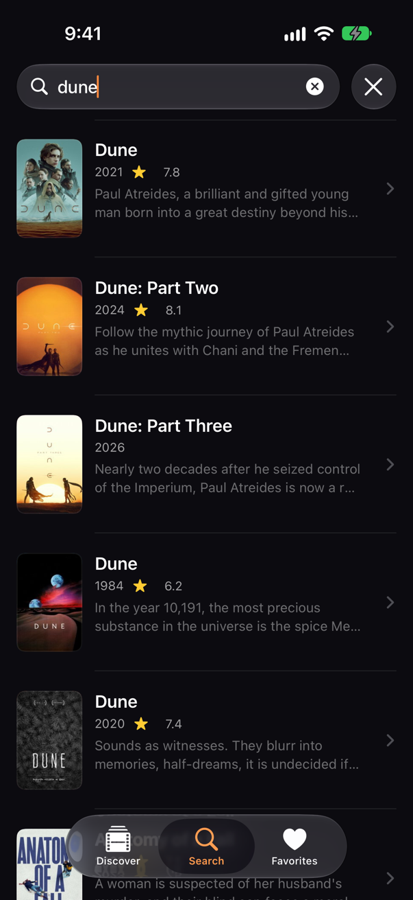
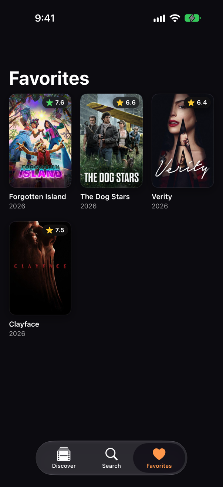

# Filmy

[](https://github.com/VasuChovatiya/Filmy/actions/workflows/ci.yml)

A SwiftUI movie browser built on [The Movie Database (TMDB)](https://www.themoviedb.org) API. Browse
trending and popular films, search the catalog, open a film's details, watch its trailer, see where to
stream it, and keep a list of favorites.

<p align="center">
  
</p>

## Features

- **Discover:** Trending, Popular, Now Playing, Top Rated and Upcoming, with infinite scrolling.
- **Search:** results update as you type (debounced) and load more pages as you scroll.
- **Movie detail:** backdrop, rating, runtime, genres, overview and cast.
  - Play Trailer and a Videos strip, which open YouTube.
  - Where to Watch: stream, rent and buy options for your region, with data from JustWatch.
  - More Like This: recommended films.
- **Favorites:** saved on the device with SwiftData.
- **Zoom transition:** on iOS 18 and later, the poster zooms into the detail screen.
- **iPhone and iPad:** the grid adds columns on wider screens, and detail text keeps a readable width.
- **Accessibility:**
  - Layouts adapt up to the largest Dynamic Type sizes.
  - VoiceOver reads each poster as one element, for example "Dune: Part Two, 2024, rated 8.1 out of 10".
- **Demo mode:** with no TMDB token, the app runs on a built-in offline catalog.

## Screenshots

| Discover | Detail | Where to Watch |
| --- | --- | --- |
|  |  |  |

| More Like This | Search | Favorites |
| --- | --- | --- |
|  |  |  |

## Requirements

- Xcode 26 or later
- iOS 17 or later (the zoom transition needs iOS 18)

## Setup

1. Clone the repo and open `Filmy.xcodeproj`. Xcode fetches the
   [NetworkingKit](https://github.com/VasuChovatiya/NetworkingKit) package automatically.
2. Optional: to use live TMDB data, add your token. Without one, the app runs in demo mode.

   ```sh
   cp Config/Secrets.example.xcconfig Config/Secrets.xcconfig
   ```

   Paste your TMDB **API Read Access Token** (themoviedb.org → Settings → API) into
   `Config/Secrets.xcconfig`. Git ignores that file, so the token is never committed.
3. Run the **Filmy** scheme.

## Architecture

MVVM with a repository layer, using Swift 6 strict concurrency.

```
Filmy/
├── App/           App entry point and dependency wiring (live, demo, previews)
├── Features/      Screens and their @Observable view models
│   ├── Discover/      Lists with pagination (MovieListViewModel)
│   ├── Search/        Debounced search (SearchViewModel)
│   ├── MovieDetail/   Detail, trailer, videos, where to watch, more like this
│   ├── Favorites/
│   └── Root/          Tab view
├── Data/
│   ├── API/           TMDB endpoints, DTOs, client configuration
│   ├── Repository/    MovieRepository protocol and the DTO → model mapper
│   ├── Models/        Movie, MovieDetail, Video, WatchOptions
│   ├── Persistence/   SwiftData FavoriteMovie
│   ├── Images/        ImagePipeline: memory and disk image cache
│   └── Demo/          Offline catalog served through a fake HTTP transport
└── Core/          Design system (colors, type, spacing, components, hero transition)
```

- **Networking:** [NetworkingKit](https://github.com/VasuChovatiya/NetworkingKit) provides `APIClient`,
  request interceptors and a `Paginator` actor. The movie detail screen makes a single request, using
  `append_to_response=credits,videos,recommendations,watch/providers`.
- **Repository:** view models depend on the `MovieRepository` protocol, never on the HTTP client.
  Tests pass a stub. Demo mode swaps in a fake transport, so the rest of the stack is the same code.
- **Images:** `ImagePipeline` is an actor that keeps decoded images in `NSCache` and the original
  bytes on disk.

## Testing

```sh
# Unit tests (Swift Testing): view models, favorites store, mapper, error messages, demo data
xcodebuild test -project Filmy.xcodeproj -scheme Filmy \
  -destination 'platform=iOS Simulator,name=iPhone 17' -only-testing:FilmyTests

# UI smoke tests (XCTest): run offline on demo data, no token needed
xcodebuild test -project Filmy.xcodeproj -scheme Filmy \
  -destination 'platform=iOS Simulator,name=iPhone 17' -only-testing:FilmyUITests/FilmyUITests \
  -parallel-testing-enabled NO
```

`ScreenshotTests` regenerates the screenshots above from live data. It is skipped unless you set
`TEST_RUNNER_FILMY_CAPTURE=1`. Set `TEST_RUNNER_FILMY_CAPTURE_DIR` to a folder to save the PNGs there.

CI ([`.github/workflows/ci.yml`](.github/workflows/ci.yml)) runs both suites on every push and pull
request.

## Attribution


This product uses the TMDB API but is not endorsed or certified by TMDB. Streaming availability
data is provided by [JustWatch](https://www.justwatch.com).
